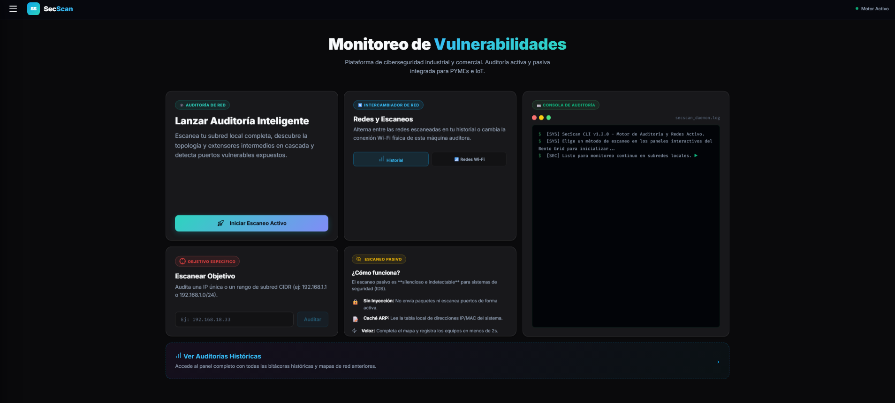
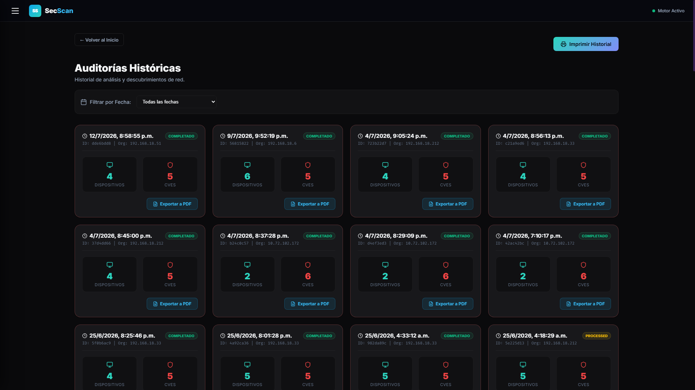
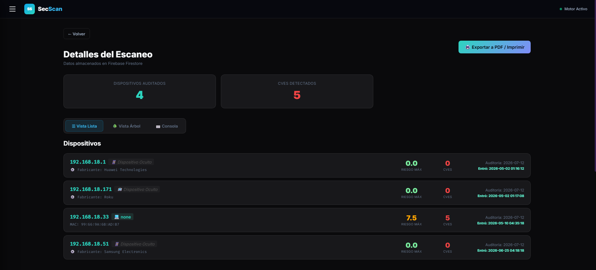
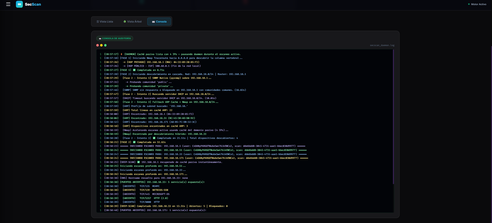
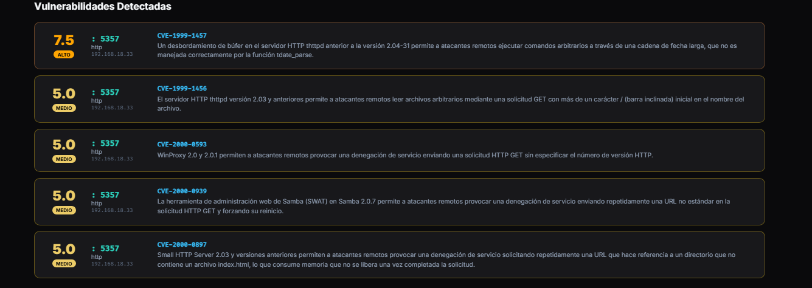

# Skop0 — Network Vulnerability & Topology Scanner (by NoneIT)

Plataforma de escritorio y monitoreo de ciberseguridad de red que descubre dispositivos en Capa 2/3, construye mapas de topología interactivos en tiempo real, audita puertos expuestos y cruza servicios con vulnerabilidades CVE (NVD API v2).


---

## Descarga Directa (Instalador de Windows)

- **Último Release Oficial (`v1.3.0`):** [Descargar `Skop0_Setup_v1.3.0.exe`](https://github.com/MartinQuintana2077/skop0/releases/latest)

---

## Capturas de Pantalla



| Dashboard — Historial de Escaneos | Resultados — Lista de Dispositivos |
|:---:|:---:|
|  |  |

| Consola de Auditoría | Reporte de Vulnerabilidades |
|:---:|:---:|
|  |  |

---

## Características Principales (`v1.3.0`)

- **Descubrimiento L2/L3 Ultrarrápido** — Barrido ARP nativo asíncrono con Nmap XML (`-PR`), enriquecimiento mDNS/SSDP/UPnP/NetBIOS y detección multi-interfaz (Ethernet / Wi-Fi).
- **Escaneo Profundo en 2 Etapas (5× más veloz)** — Barrido SYN en lote sobre el perfil curado de 78 puertos críticos seguido de detección de versiones (`-sV`) y captura de banners HTTP únicamente en puertos abiertos confirmados.
- **Puente Automático de Subred (`Subnet Bridge`)** — Audita cámaras IP o equipos en segmentos estáticos distintos (ej. `192.168.20.0/24`) sin desconectar tu sesión de Internet y con verificación anti-colisión ARP.
- **Motor CVE NVD v2.3 de Alta Precisión** — Conversión automática CPE 2.2 → 2.3 (`cpeName`), filtro de falsos positivos genéricos, deduplicación en vuelo, caché SQLite con TTL y traducción automática al español.
- **Clasificador de Dispositivos v2 & Telemetría Multi-Fallback** — Identificación precisa de CCTV/RTSP, Smart TVs, Roku, Chromecast, servidores, impresoras, routers e IoT, con medición RTT vía ICMP, TCP, Nmap SRTT y L2 ARP.
- **Topología Interactiva & Planos de Planta** — Árbol jerárquico L2/L3, vista de burbujas y ubicación de nodos sobre el plano de tu oficina o planta.
- **5 Paletas de Color & 3 Modos de Vista** — *Original (Cyan/Violeta)*, *Esmeralda*, *Ámbar*, *Índigo* y *Carmesí*, con diseños *Clásico*, *Enfoque Minimalista* y *Centro de Mando*.
- **Arquitectura Local-First + Respaldos `.skop0`** — Historial local instantáneo en SQLite con exportación/importación portátil y validación de licencias en tiempo real con Firebase.

---

## Tech Stack

| Capa | Tecnología |
|---|---|
| Backend API | Python 3.11, FastAPI, Uvicorn |
| Motor de Red | Nmap XML (`ElementTree`), SNMP (`pysnmp`), Windows `iphlpapi` (`SendARP`), `psutil` |
| Base de Datos CVE | NIST NVD REST API v2 (CPE 2.3 + CVSS v3.1) |
| Frontend | React 18, Vite, Lucide Icons |
| Persistencia | SQLite (Local-First) + Firebase Authentication & Firestore |
| Empaquetado | PyInstaller + Inno Setup (`Skop0_Setup_v1.3.0.exe`) |

---

## Instalación para Desarrollo

### 1. Clonar el repositorio
```bash
git clone https://github.com/MartinQuintana2077/skop0.git
cd skop0
```

### 2. Configurar el Backend
```bash
cd backend
python -m venv venv
.\venv\Scripts\activate
pip install -r requirements.txt
```

### 3. Configurar el Frontend
```bash
cd frontend
npm install
npm run build
```

### 4. Ejecutar en Desarrollo
```bash
python backend/launcher.py
```

---

## Estructura del Proyecto

```
skop0/
├── backend/
│   ├── app.py                      # Servidor FastAPI + WebSocket de ciclo de vida
│   ├── launcher.py                 # Lanzador de instancia única y ventana aislada
│   ├── core/
│   │   ├── scanner.py              # Motor Nmap XML en 2 etapas + ARP/mDNS/SSDP/SNMP
│   │   ├── cve_client.py           # Cliente NVD API v2 (CPE 2.3 + rate limiter + caché)
│   │   ├── device_classifier.py    # Clasificador determinista de dispositivos v2
│   │   ├── telemetry.py            # Telemetría RTT/jitter multi-fallback
│   │   ├── subnet_bridge.py        # Puente automático hacia subredes externas
│   │   ├── lifecycle.py            # Cierre limpio automático al cerrar la ventana
│   │   ├── updater.py              # Actualizador OTA conectado a GitHub Releases
│   │   └── local_db.py             # Gestor SQLite thread-safe
│   ├── services/
│   │   ├── scan_service.py         # Orquestador de auditoría activa y demonio pasivo
│   │   └── db_service.py           # Abstracción de persistencia y logs concurrentes
│   ├── api/v1/endpoints/           # Endpoints REST de auditoría, red y respaldos
│   └── tests/
│       └── test_secscan_engine.py  # Suite de 23 pruebas unitarias del motor
└── frontend/
    └── src/
        ├── App.jsx                 # Consola principal y vistas de auditoría
        ├── components/
        │   ├── Skop0Logo.jsx       # Emblema oficial SVG adaptable a las 5 paletas
        │   ├── NetworkTree.jsx     # Mapa topológico interactivo y plano de planta
        │   ├── AppearanceModal.jsx # Selector de paletas y modos de diseño
        │   ├── BackupModal.jsx     # Exportación/importación de copias .skop0
        │   └── UpdateModal.jsx     # Actualizador integrado
        └── pages/
            ├── LoginPage.jsx
            └── ScanHistoryPage.jsx
```

---

## Autor

**Martín Quintana** — **NoneIT** · Seguridad de Redes & Desarrollo Full-Stack
